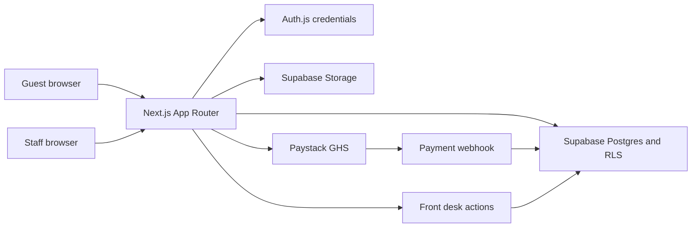

# The Winford Hotel Booking Platform

## Codebase audit and product pitch

**Review date:** 26 November 2026  
**Review type:** Static source and migration review of the current working tree, with the project test suite and production build run. This is not a penetration test, production database inspection, or browser/device test.

## Executive summary

This repository contains a Next.js App Router hotel website and booking application for The Winford Boutique Hotel Achimota. Guests can browse rooms, create or use an account, submit bookings, and pay through Paystack in GHS. The project also includes a staff room editor, image management, a front-desk walk-in booking flow, and administrator queues for guest enquiries and payment exceptions. Auth.js provides credentials-based sign-in, while Supabase provides Postgres, Row Level Security (RLS), and image storage.

The latest changes close the broad guest reservation write path in source: authenticated roles no longer receive reservation insert/update access, guest mutations go through server-only functions, and the Supabase guest JWT is no longer exposed in the Auth.js session. A new migration must still be applied to the deployed database before this protection is active there. OAuth providers and UI have been removed. Delayed paid transactions that lose their room hold now create a durable staff payment-exception item. Guest enquiries have an administrator inbox and email-based rate limiting. Room uploads are decoded and re-encoded as WebP before storage.

### Assessment at a glance

| Area | Assessment |
| --- | --- |
| Product coverage | A broad first version: hotel discovery, room booking, accounts, online payment, room administration, and front-desk walk-ins. |
| Architecture | Next.js App Router, Auth.js JWT sessions, Supabase Postgres and Storage, server actions and route handlers. |
| Booking integrity | Checkout holds and an exclusion constraint protect room inventory; direct guest reservation writes are revoked by the new migration. |
| Payment handling | Paystack transactions are initialized server-side; webhook signatures and transaction status are verified before a hold is confirmed. |
| Data protection | The old guest listing API and OAuth flows are removed. Reservation writes are routed through scoped server-side functions. |
| Operational readiness | Apply the new migration and configure staff to monitor the contact and payment exception queues. Business policy decisions remain. |
| Review confidence | 10 Node tests passed and the production build passed. Lint could not start because the installed ESLint configuration requires a missing `typescript` package. No live database, payment sandbox, or browser session was used. |

## 1. Product scope

Capabilities represented in the source include:

- Public hotel homepage, gallery, location/contact details, and room highlights.
- Room catalogue with date availability, filtering, and sorting.
- Room detail pages with descriptions, features, images, and booking controls.
- Credential registration/sign-in, guest profile, and booking history. OAuth is currently disabled.
- Paystack checkout in Ghana cedis (GHS), payment return page, and webhook processing.
- Reservation editing and cancellation.
- Allowlisted staff room and image administration.
- Front-desk guest lookup and walk-in reservations with cash, mobile-money transfer, or POS payment recording.
- Contact form that stores enquiries in Supabase.

These are code capabilities, not confirmation that the production environment is configured or that hotel operating policies have been approved.

## 2. Architecture

### Main code areas

| Location | Responsibility |
| --- | --- |
| `app/page.js`, `app/_components/` | Homepage and shared presentation components. |
| `app/rooms/` | Room discovery, availability filtering, details, and date selection. |
| `app/reservations/`, `app/payment/` | Checkout, reservation changes, payment return, and confirmation/expiry screens. |
| `app/signin/`, `app/signup/`, `app/account/` | Authentication, profile, and reservation history. |
| `app/admin/`, `app/api/admin/` | Room management, image management, and front-desk workflow. |
| `app/api/paystack-webhook/` | Signed Paystack webhook handler. |
| `app/_lib/` | Authentication helpers, validation, Supabase access, Paystack integration, and business logic. |
| `supabase/migrations/` | Schema, RLS policies, payment fields, room features, holds, write restrictions, payment exceptions, and contact queue logic. |
| `supabase/seed.sql` | Example room catalogue; rates are starter values pending hotel approval. |

### Main routes

| Route | Purpose |
| --- | --- |
| `/` | Hotel landing page. |
| `/rooms` | Browse and filter rooms. |
| `/rooms/[room_slug]` | Room details; the current segment is a numeric room ID. |
| `/reservations/checkout` | Guest details and Paystack initialization. |
| `/payment` | Payment return and booking status. |
| `/reservations/edit/[id]` | Edit an eligible reservation. |
| `/signin`, `/signup` | Guest and staff sign-in/registration. |
| `/account/profile`, `/account/history` | Guest account management. |
| `/admin/rooms` | Allowlisted room and image maintenance. |
| `/admin/front-desk` | Staff walk-in guest lookup and booking. |
| `/admin/inbox` | Staff queue for guest enquiries. |
| `/admin/payment-exceptions` | Staff queue for paid bookings that need refund/reconciliation review. |
| `POST /api/paystack-webhook` | Verify Paystack events and confirm paid holds. |
| `POST /api/admin/rooms`, `PATCH`, `DELETE` | Allowlisted room mutations. |
| `POST/DELETE /api/admin/room-images` | Allowlisted room image mutations. |
| `/api/auth/[...nextauth]` | Auth.js endpoints. |
| `POST /api/clear-pending-reservation` | Clear pending-booking browser cookies. |

The old `GET /api/guests` endpoint noted in the prior report is absent from this working tree.

## 3. Technical audit

This section tracks the findings from the prior review against the updated working tree. Source changes that add migrations do not take effect in the hosted database until those migrations are applied.

### High priority

#### H1. Guest RLS permits direct reservation creation and state changes — fixed in source; migration required

The initial migration had broad reservation insert/update grants. The new `20261126000000_booking_and_operations_hardening.sql` migration revokes those grants and adds service-role-only functions for editing, cancelling, and hiding eligible reservations. App actions derive the guest ID from the Auth.js session and call these functions through a server-only client. The Auth.js session no longer includes a Supabase guest JWT. The earlier migration's permissive policies remain in history, so the new revoke migration must be applied to production.

**Deployment step:** Apply the new migration, then verify guest-role insert/update privileges are revoked in the deployed Supabase project. The RPC functions are callable only by `service_role`; online booking confirmation remains in the verified payment path.

#### H2. OAuth sign-in — disabled

Google/Facebook providers, OAuth callback logic, sign-in buttons, adapter package, and related environment settings have been removed. Legacy `next_auth` tables are left in the historical migration for existing deployments; they are not used by the app.

**Status:** No OAuth authentication is configured. Guest signup checks and reports database creation errors.

### Medium priority

#### M1. Reservation editing — server-side checks and database constraint

`reservationUpdateAction` checks ownership, status, future start date, guest count, and date overlap, then calls a service-role-only RPC that repeats ownership, status, date, and capacity checks. The exclusion constraint catches overlapping active stays if two edits race. Direct guest updates are blocked by H1's migration.

**Status:** Regression tests cover half-open turnover dates, active holds, editable states, and guest capacity.

#### M2. Late payment exception queue — added

The claim RPC creates a pending hold for 15 minutes. If a verified payment cannot confirm its hold, the reservation is marked `conflict_refund_required` and a durable payment exception is written. Allowlisted staff can review and record follow-up at `/admin/payment-exceptions`, including a refund reference and notes.

**Operational limit:** The queue records and tracks staff follow-up; it does not initiate a Paystack refund automatically. Staff must complete the refund/reconciliation with the provider and record the outcome.

#### M3. Database read errors — surfaced

Room and reservation reads now distinguish a successful empty result from a failed query: catalogue/detail helpers throw a user-safe error, while availability helpers return an explicit error consumed by the page. Reservation history/detail queries throw on database errors.

**Status:** Build succeeded. Live database failure behavior has not been exercised.

#### M4. Contact enquiry workflow — added

Contact messages now enter an administrator-only inbox at `/admin/inbox`, where staff can track new, in-progress, and resolved items. The database submission function serializes submissions by normalized email and caps each address at three per hour.

**Operational limit:** This is email-based throttling; it is not a full anti-spam service or notification system. Assign staff to monitor the inbox.

#### M5. Admin upload content — decoded and normalized

Each room card supports batch selection of up to 10 images. The image route enforces the allowlist, per-file size limit, and MIME allowlist, checks each file signature, decodes images with Sharp under a pixel limit, applies orientation, and re-encodes them to WebP before upload. The first successfully uploaded image can be assigned as the room cover. Storage paths and content types are set server-side.

**Status:** Added a Sharp dependency and tests for valid normalization and malformed input rejection. Upload rate limiting remains a future hardening item.

### Lower priority / business readiness

#### L1. Prices and guest surcharges need hotel approval

`app/utils/reservationsCalcs.js` applies a per-additional-guest price increase, and the seed file contains example GHS room prices. Confirm rates, taxes, and surcharge rules with hotel management before publishing prices or charging guests.

#### L2. Payment and cancellation promises need written policy

The code represents pending holds, confirmed reservations, cancellation, and walk-in payment methods. Confirm cancellation/refund terms, no-show handling, the hold duration, and the exact point at which a reservation is guaranteed. Ensure the customer-facing copy matches the operating procedure.

#### L3. Legacy Stripe data remains alongside current Paystack bookings

Migrations preserve Stripe session identifiers and record historical USD currency while new direct bookings use GHS. Reporting and account history must display each reservation's stored currency and payment provider instead of assuming one currency.

#### L4. Automated regression coverage — added

The project now has a `test` script using Node's built-in test runner. Eleven tests cover booking rules, image validation/normalization, OAuth removal, reservation grant revocation, payment verification idempotency, and contact throttle/queue contracts. The production build completed successfully. The lint command could not start because the installed Next ESLint config requires a `typescript` package that is absent from `node_modules`.

## 4. Security and operational notes

### Controls visible in source

- The old broad guest lookup API has been deleted from this tree.
- Guest profile and reservation read policies check guest ownership.
- Guest credential passwords are hashed with bcrypt before storage.
- Privileged Supabase access is server-only and exposed through a small set of helper methods rather than a general client export.
- Admin endpoints check a configured email allowlist and reject a mismatched Origin header when present.
- Payment initialization derives room price and guest capacity server-side and creates a hold through a privileged database RPC.
- The database exclusion constraint prevents overlapping pending/confirmed reservations using half-open date ranges.
- The webhook checks a signature and independently verifies transaction status with Paystack before attempting to confirm a hold.
- Room image uploads are signature-checked, decoded, pixel-limited, and re-encoded as WebP.

The new reservation-write restriction takes effect in production only after the latest migration is applied and its grants are verified.

### Deployment dependencies to verify

Use `.env.example` as the environment variable checklist. Confirm production values are set in the hosting platform and match the same Supabase project. Do not copy secret values into this report or source control.

- Supabase URL, publishable key, server-side secret key, and schema.
- `AUTH_SECRET` and staff Supabase Auth accounts with trusted `app_metadata.role = admin`.
- Paystack secret key and webhook URL/signing configuration.
- `NEXT_PUBLIC_APP_URL` and image bucket configuration.
- All migrations applied in order, especially the hold/exclusion, walk-in, and `20261126000000_booking_and_operations_hardening.sql` changes.
- Public room image bucket and appropriate storage policies.
- No OAuth provider credentials are required; historical `next_auth` tables are unused.
- Staff assigned to review `/admin/inbox` and `/admin/payment-exceptions`, plus procedures for webhooks, refunds, contact enquiries, and backups.

The local `.env.local` file was not read or included in this review.

## 5. Recommended work order

1. Apply the new Supabase migration in production and verify direct guest reservation writes are denied.
2. Assign staff owners and response expectations for the enquiry inbox and payment exception queue.
3. Add provider-side refund execution and reconciliation if staff need refunds initiated from the application.
4. Confirm rates, occupancy rules, cancellation/refund terms, and booking guarantee language with hotel management.
5. Extend automated checks to cover deployed RLS behavior, payment retries, delayed payment handling, admin authorization, and walk-in bookings.
6. Add monitoring and alerting for payment callbacks, unresolved payment exceptions, database failures, image storage errors, and contact enquiries.
7. Install the missing `typescript` development dependency or adjust the ESLint setup so lint can run reliably.

## 6. Plain-language explanation

The website acts as an online front desk. Guests can look through the rooms, choose dates, create an account, and pay online. Staff can update room details and photos, and record guests who arrive or book by phone. The website stores booking information in a database and uses Paystack to collect online payments.

Guest booking writes now go through server-side checks, and staff have a queue to review successful payments whose room holds could not be confirmed. The new database migration must be applied in production for the reservation restrictions to take effect. Staff also need to monitor the enquiry inbox and record payment follow-up; the app records refund outcomes but does not process Paystack refunds itself.

## 7. Pitch and marketing version

### Short pitch

**A warmer, simpler way to book your stay at The Winford Boutique Hotel Achimota.** Explore the rooms, choose your dates, and arrange your stay online, with a direct payment option and a personal hotel team ready to help.

### Guest-facing website copy

**Your stay in Achimota starts here.**  
Discover The Winford Boutique Hotel, explore the rooms, and plan your visit in a few simple steps. Choose the dates that suit you, review your booking details, and continue to secure payment. Need help before you arrive? Get in touch with our team.

### Value proposition

- **Explore with clarity:** See room details, features, and photos before choosing your stay.
- **Plan your visit:** Select dates and guest numbers, review your booking, and continue to payment.
- **Keep plans together:** Sign in to view your booking history and manage eligible reservations.
- **Reach the hotel team:** Send an enquiry through the website or speak with the front desk.

### Hotel-team pitch

The platform brings room discovery, online booking, guest accounts, and basic room maintenance together in one website. Staff can also record walk-in bookings and payment methods through a front-desk workflow. The codebase provides a foundation for direct GHS bookings; limiting guest database writes and establishing payment exception handling are the next steps toward dependable live operations.

### Claims to confirm before publishing

- Room rates, taxes, and additional-guest charges.
- Whether a successful payment guarantees the room and how long checkout holds it.
- Cancellation, modification, refund, and no-show conditions.
- Payment methods enabled on the live Paystack account.
- Room features, accessibility details, and image accuracy.
- Who handles enquiries and expected response times.

## 8. Review boundaries and source references

The review considered the current working-tree application routes and components, Auth.js configuration, Supabase helpers, SQL migrations, seed file, package configuration, environment example, README, and installed Next.js 16 guidance for route handlers and server actions. The Next.js guidance emphasizes that server actions are directly reachable and must perform authentication and authorization checks; this report applies that principle to the current mutation paths.

The Node test suite passed (11 tests), and `next build` completed successfully. `npm run lint` could not start because the installed ESLint configuration imports `typescript`, which is missing from `node_modules`. No live database inspection, payment sandbox, production configuration review, or browser/device test was performed. The working tree already contains many modified, deleted, and untracked files. This document describes the files as they exist in the working tree and does not attribute those changes to this audit.

Key source references:

- `supabase/migrations/20261113000000_initial_schema.sql` — original reservation grants and ownership-only RLS policies.
- `supabase/migrations/20261126000000_booking_and_operations_hardening.sql` — guest write revocation, scoped mutation RPCs, payment exception queue, and contact throttling.
- `supabase/migrations/20261119000000_booking_hardening_walk_ins.sql` — exclusion constraint, hold function, reservation states, and walk-in support.
- `app/_lib/actions.js` — guest reservation update and cancellation server actions.
- `app/_lib/paystack.js`, `app/_lib/supabase/privilegedReservations.js`, `app/api/paystack-webhook/route.js` — payment hold, verification, and confirmation.
- `auth.js`, `app/_lib/authjs/credentialsCallback.js` — credentials-only guest and administrator sessions.
- `app/admin/inbox/`, `app/admin/payment-exceptions/` — staff follow-up queues.
- `app/_lib/imageValidation.js`, `app/api/admin/room-images/route.js` — image decoding and WebP normalization.
- `tests/` — booking, image, and security-contract regression tests.
- `app/_lib/supabase/rooms.js` — room availability and error handling.
- `app/api/admin/room-images/route.js` — privileged room image upload/removal.
- `app/admin/front-desk/actions.js` — guest lookup and walk-in booking.
- `supabase/seed.sql`, `app/utils/reservationsCalcs.js` — starter prices and pricing logic.
- `package.json`, `.env.example`, `README.md` — scripts, configuration, and deployment assumptions.
