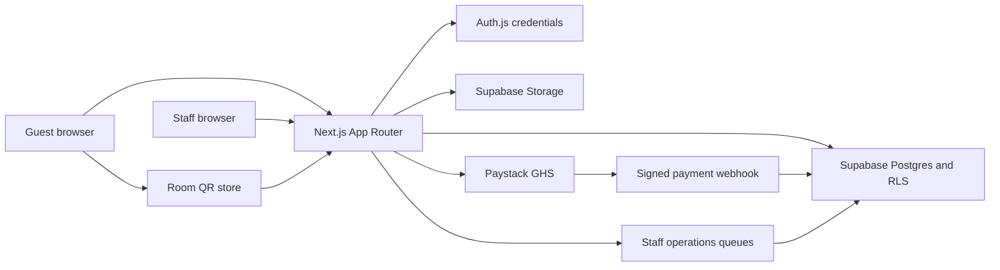

# The Winford Hotel Booking and Guest Services Platform

## Codebase audit and product pitch

**Review date:** 26 November 2026  
**Review type:** Static review of the current working tree, application routes, SQL migrations, configuration, and documentation. No tests or build were run for this update. This is not a penetration test, production database inspection, payment sandbox exercise, or browser/device review.

## Executive summary

This repository contains a Next.js App Router website and guest operations application for The Winford Boutique Hotel Achimota. Guests can browse room types and a curated property gallery, create an account, book and pay online in GHS through Paystack, manage eligible future reservations, and use an in-stay room-service menu. Staff have tools for room type and physical-room inventory, guest arrivals and check-in/out, walk-in bookings, room-service orders, store products, guest enquiries, payment exceptions, room photos, and property-gallery curation.

The backend uses Auth.js credentials sessions, Supabase Postgres with RLS and narrowly scoped privileged operations, Supabase Storage, and database functions/constraints for booking and order rules. Recent migrations add separate room types and numbered physical units, reservation transaction records, checked-in reservation protections, room-service product imagery, guest room-service ordering, and property gallery management. USD room prices are explicitly display-only; booking and payment amounts remain GHS.

**WhatsApp and email automation are intentionally on hold.** The current product provides an enquiry inbox and direct `mailto:`/`tel:` links for staff follow-up, but no automated email notifications or WhatsApp messaging integration. Keep those integrations out of current capability claims until the hotel chooses a provider, approves message content and consent/operating rules, and schedules implementation.

These are source-level capabilities. Migration files do not prove that the deployed database has been upgraded, and this review did not inspect production configuration or exercise external services.

### Assessment at a glance

| Area | Assessment |
| --- | --- |
| Guest product | Room discovery, property gallery, accounts, booking and Paystack checkout, reservation management, and in-stay room-service ordering. |
| Staff operations | Room types and numbered units, front desk, check-in/out, walk-ins, room-service queue, store management, enquiry inbox, payment exceptions, and gallery management. |
| Booking integrity | Inventory-aware reservation protection and payment hold flow are represented in migrations and source; deployed behavior depends on applying migrations. |
| Payment records | Paystack GHS flow plus a transaction ledger supporting provider references, manual records, refunds, and legacy Stripe data. The app does not automatically issue Paystack refunds. |
| Messaging | WhatsApp and email automation intentionally on hold. Staff handle enquiries from the admin inbox. |
| Review confidence | Static source/migration review only for this update. No build, tests, lint, live database, payment sandbox, or browser verification was performed. |

## 1. Product scope

### Guest-facing capabilities

- Public hotel website with property information, location/contact details, room highlights, and a published property photo gallery.
- Room catalogue with date availability, filtering, sorting, features, images, and room-type descriptions.
- Credential registration and sign-in, profile, booking history, and eligible future reservation edits/cancellations.
- Online booking checkout and Paystack payment in Ghana cedis (GHS).
- Room-service menu reachable from the public store page and room QR links. Guests can submit orders against an active assigned stay; QR access uses a stay access code.
- Room-service order status tracking for signed-in guests.

### Staff capabilities

- Admin room type editing, pricing, inventory counts, features, and room imagery.
- Management of numbered physical room units and their QR access tokens.
- Front-desk arrival/occupied-stay view, guest lookup, check-in/check-out, and walk-in reservation/payment recording.
- Room-service product and image management, order queue, order status handling, and new-order indicator polling in the admin navigation.
- Store product management, guest enquiry inbox, payment-exception follow-up, and curated property-gallery upload/publish/order/removal.
- Transaction history records for online and manually recorded payments/refunds.

### Explicitly deferred

WhatsApp and email automation are intentionally on hold. No automatic booking confirmations, reminders, enquiry notifications, or WhatsApp messages should be represented as available. The contact form stores enquiries for staff review; staff can initiate contact using the displayed email/phone links.

## 2. Architecture and principal routes

| Route | Purpose |
| --- | --- |
| `/` | Hotel landing page and property content. |
| `/rooms`, `/rooms/[room_slug]` | Room-type discovery, availability, details, and booking. |
| `/reservations/checkout`, `/payment` | Checkout, payment return, and booking status. |
| `/reservations/edit/[id]`, `/account/*` | Eligible reservation changes, profile, and history. |
| `/store` | Room-service menu and signed-in active-stay ordering. |
| `/store/room/[qrToken]` | Room QR menu/order flow with stay access verification. |
| `/admin/rooms` | Room types, pricing, inventory, and images. |
| `/admin/front-desk` | Arrivals, occupied stays, guest lookup, and walk-ins. |
| `/admin/room-service`, `/admin/store` | Room-service order and product operations. |
| `/admin/gallery` | Property gallery management. |
| `/admin/inbox`, `/admin/payment-exceptions` | Guest enquiry and payment follow-up queues. |
| `/api/paystack-webhook` | Verify Paystack events and confirm paid reservations. |
| `/api/store/orders`, `/api/store/orders/status` | Guest order submission and status retrieval. |
| `/api/admin/*` | Allowlisted staff mutations for rooms, images, gallery, store, and room service. |

Core code lives under `app/`; SQL schema and access changes are under `supabase/migrations/`. Auth.js handles sessions; Supabase provides Postgres and image storage; Paystack handles online GHS checkout.

## 3. Technical audit and deployment considerations

### Reservation and payment controls

Guest reservation changes use server actions and server-only privileged functions with ownership, status, date, and capacity checks. The security migration revokes broad direct guest reservation writes. Availability is protected by database inventory/overlap logic, and checkout uses a temporary hold before payment. The webhook verifies the signature and independently checks transaction status and booking details before confirmation. A late successful payment that cannot claim its hold is sent to a staff payment-exception queue.

**Deployment dependency:** Apply every migration in order, including `20261126000000_booking_and_operations_hardening.sql`, `20261127000000_room_type_inventory.sql`, `20261130000000_room_service_and_physical_rooms.sql`, `20261202000000_guest_room_service_orders.sql`, `20261203000000_reservation_transactions.sql`, `20261204000000_protect_checked_in_reservations.sql`, and `20261205000000_property_gallery.sql`. Confirm the deployed Supabase project matches the app configuration and verify grants/RPC availability. Source presence alone does not activate database changes.

The payment-exception UI records staff review and refund details; it does not initiate provider refunds. The transaction ledger keeps payment attempts and manual/legacy records distinct from reservation lifecycle data. Historical Stripe/USD data remains in the schema, so reports must respect each transaction's stored provider and currency.

### Physical inventory and stay lifecycle

The schema distinguishes bookable room types from numbered physical room units, associates stays with units, and generates QR tokens for rooms. Front desk operations include arrival and occupied-stay workflows. The checked-in reservation migration adds database-side protections against changing stays after check-in. Validate the initial temporary room labels against the hotel's actual room numbering before relying on unit assignment or printing QR codes.

### Room service and store

Guests can browse products and submit orders for an active assigned stay or through room QR access with an access code. Database functions validate active stays and product availability and create order/line-item records with GHS totals. Staff manage products and process the order queue; the admin navigation polls for a new-order count. The store and room-service workflows are in-app operations; no external notification automation is implemented.

### Gallery and image handling

Staff can curate published property-gallery images and room images. Room uploads are signature-checked, decoded with pixel limits, and normalized to WebP before storage. The gallery migration creates ordered, publishable gallery records. Confirm that the configured Supabase bucket exists and has the intended public-read policy before deployment.

### Identity, authorization, and enquiries

OAuth is disabled; guests use credentials and staff authenticate through Supabase Auth with trusted `app_metadata.role = admin`. Privileged database access is server-only. Staff routes and endpoints should continue to use the shared admin-session checks. Contact submissions are stored for administrator review and throttled by normalized email (three per hour in the current database workflow). This is not an email notification system or a full anti-spam service.

### Business and operational decisions

- Approve GHS rates, occupancy rules, taxes, and any additional-guest charges before accepting live bookings.
- Confirm cancellation, refund, no-show, hold duration, check-in/out, and booking guarantee policies.
- Establish staff owners and response expectations for the enquiry, payment exception, front-desk, and room-service queues.
- Validate room-unit numbering and QR access-code issuance/revocation procedures.
- Decide how staff settle room-service folios and record manual payments/refunds.
- Keep WhatsApp and email automation marked as intentionally on hold until provider, consent, templates, and ownership are approved.

## 4. Configuration and readiness checklist

Use `.env.example` for the authoritative variable list. Configure secrets only in the hosting platform and never commit them. This review did not read `.env.local` or inspect live configuration.

- Supabase URL, publishable key, server-side secret key, schema, and image bucket.
- `AUTH_SECRET`, plus staff accounts with trusted administrator app metadata.
- Paystack secret key, webhook endpoint, and provider dashboard configuration.
- `NEXT_PUBLIC_APP_URL` and production host configuration.
- All migrations applied in order; verify the new room service, transaction, checked-in stay, and gallery schema in the deployed project.
- Public image bucket read behavior and upload/delete policies.
- Staff assigned to inbox, payment exception, front desk, and room-service queues.
- Hotel-approved rates and policies reflected in site copy and operations.
- WhatsApp and email automation remain off/on hold; do not configure or promise them as live features.

## 5. Recommended next steps

1. Reconcile and apply migrations to the intended production Supabase project; verify critical constraints, grants, and functions.
2. Replace temporary physical-room labels with approved room numbers and prepare QR issuance/access procedures.
3. Validate an end-to-end test booking, payment webhook, check-in/out, room-service order, and staff queue workflow in a non-production environment.
4. Confirm pricing, cancellation/refund, no-show, room-service settlement, and check-in policies with hotel management.
5. Assign queue ownership and operational response targets, including payment exception reconciliation.
6. Add monitoring for webhook failures, database errors, unresolved exceptions, image failures, and unprocessed room-service orders.
7. Review automated regression coverage for inventory concurrency, physical room assignment, check-in protection, guest ordering authorization, transaction/refund records, and admin boundaries.
8. Revisit WhatsApp/email automation only when intentionally taken off hold and requirements are approved.

## 6. Plain-language explanation

The platform gives guests one place to explore the hotel, choose a room and dates, book, pay, and manage eligible upcoming reservations. During a stay, guests can use the room-service menu from the website or a room QR code. Hotel staff can manage rooms and photos, assign numbered rooms, handle arrivals and walk-ins, process room-service orders, and review enquiries or payment issues.

The website stores operational records in Supabase and uses Paystack for online GHS payments. Staff still need to handle enquiries, refunds, and day-to-day follow-up. **WhatsApp and email automation are intentionally on hold**, so the system does not automatically send those messages.

## 7. Pitch and marketing version

### Short pitch

**A thoughtful, connected stay at The Winford Boutique Hotel Achimota.** Explore the rooms, plan and pay for your booking online, and enjoy a convenient room-service menu during your stay, with the hotel team supporting you at every step.

### Guest-facing website copy

**Your stay in Achimota starts here.** Explore the rooms and property, choose the dates that suit you, and arrange your stay online. Once checked in, browse the room-service menu from your room. Need help? Contact our hotel team directly.

### Value proposition

- **Choose with confidence:** Review room details, features, availability, and property photos.
- **Plan your stay:** Book dates and guest numbers, then continue to secure GHS payment.
- **Manage your plans:** Sign in to view your history and manage eligible future reservations.
- **Order during your stay:** Browse room service from the website or room QR menu.
- **Keep the team connected:** Staff use shared tools for arrivals, room service, enquiries, and payment follow-up.

### Hotel-team pitch

The platform brings direct bookings and practical guest operations into one application. Staff can manage room types and numbered units, arrivals, walk-ins, room-service products and orders, property imagery, guest enquiries, and payment follow-up. It provides an operational base for a connected guest experience, while refunds and guest communications still require staff handling.

### Claims to confirm before publishing

- Room rates, taxes, occupancy, and additional guest charges.
- Payment methods enabled for the live Paystack account and booking guarantee wording.
- Cancellation, change, refund, and no-show conditions.
- Room-service hours, product availability, pricing, and settlement process.
- Accurate room numbers, QR access instructions, amenities, and images.
- Staff contacts and enquiry response expectations.
- Do not claim automated WhatsApp or email messages; both are intentionally on hold.

## 8. Review boundaries and source references

This update reviewed the working-tree routes and components, authentication and Supabase helpers, SQL migrations through `20261205000000_property_gallery.sql`, package configuration, README, and the installed Next.js documentation landing page. No code implementation was changed. Per the user's repository instruction, Next.js documentation under `node_modules/next/dist/docs/` must be consulted before changing application code; this document-only update did not require framework API changes.

No tests, build, lint, live database inspection, payment sandbox, production configuration review, or browser/device test were performed for this update. The working tree may contain pre-existing edits; this report describes the observed state and does not attribute those changes to the audit.

Key references:

- `supabase/migrations/20261126000000_booking_and_operations_hardening.sql` — reservation write restrictions, scoped functions, payment exceptions, and enquiry throttling.
- `supabase/migrations/20261127000000_room_type_inventory.sql` — room-type inventory protection.
- `supabase/migrations/20261128000000_usd_display_rate.sql`, `20261129000000_room_usd_display_price.sql` — display-only USD pricing evolution; GHS remains booking currency.
- `supabase/migrations/20261130000000_room_service_and_physical_rooms.sql` — numbered room units, QR tokens, and room-service schema.
- `supabase/migrations/20261201000000_room_service_product_images.sql`, `20261202000000_guest_room_service_orders.sql` — product imagery and guest order function.
- `supabase/migrations/20261203000000_reservation_transactions.sql` — transaction ledger.
- `supabase/migrations/20261204000000_protect_checked_in_reservations.sql` — checked-in reservation protections.
- `supabase/migrations/20261205000000_property_gallery.sql` — property-gallery storage model.
- `app/store/`, `app/api/store/orders/`, `app/admin/room-service/` — guest ordering and staff order operations.
- `app/admin/front-desk/` — arrival, occupied-stay, guest lookup, and walk-in tools.
- `app/admin/gallery/`, `app/api/admin/gallery/`, `app/_lib/supabase/gallery.js` — gallery administration and public reads.
- `app/_lib/paystack.js`, `app/api/paystack-webhook/`, `app/_lib/supabase/privilegedReservations.js` — payment verification and reservation confirmation.
- `app/_lib/imageValidation.js`, `app/api/admin/room-images/` — room image validation and normalization.
- `app/admin/inbox/`, `app/admin/payment-exceptions/` — staff follow-up queues.
- `app/admin/store/`, `app/api/admin/store/` — store product operations.
- `package.json`, `.env.example`, `README.md` — scripts and setup assumptions.
